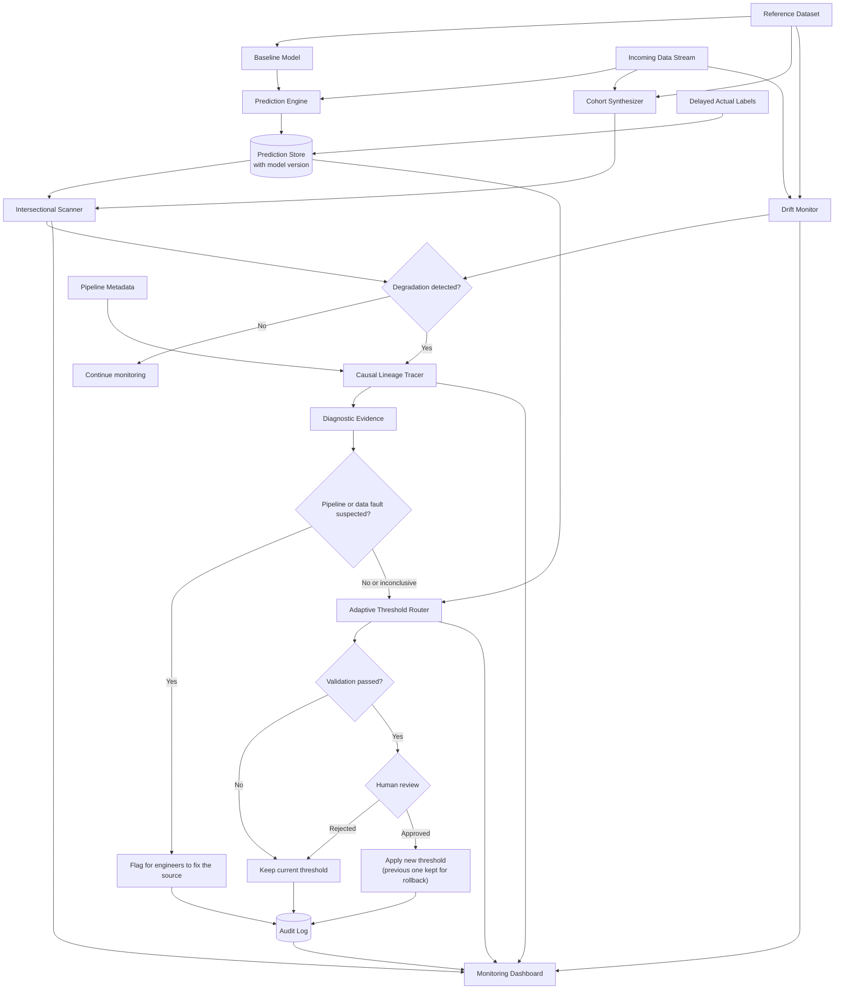

# System Architecture

## 1. Purpose

This document explains how information travels through the Integrated Fairness Intelligence System (IFIS): how the four modules work together, and how the system copes with validation, human review, model versions, late-arriving labels, and audit records.

## 2. The Big Picture

A few things this diagram makes explicit that earlier versions left vague:

- The **Prediction Engine** is the thing that uses the trained model. The Cohort Synthesizer is a separate, complementary component and never replaces it.
- A **Drift Monitor** compares incoming data with the reference data. The requirements call for drift scores, so the architecture needs a place where they come from.
- Predictions and labels meet in a **Prediction Store**, because they arrive at different times.
- **Diagnosis can change the plan.** If the evidence points to a broken data pipeline, adjusting a threshold would only mask the problem, so the system raises it with engineers instead.
- Both "validation failed" and "human rejected" lead to the same safe outcome: the current threshold stays.

## 3. How Data Moves

### 3.1 Reference dataset and baseline model
The reference dataset defines what "normal" looks like. The baseline model is trained on it. The model version is tracked from this point on.

### 3.2 Incoming data and prediction engine
Incoming observations go to the prediction engine and, in parallel, to the Cohort Synthesizer and the Drift Monitor. Each stored prediction keeps an observation reference, a timestamp, and the model version, so a label that shows up later can be matched to the right prediction.

### 3.3 Cohort Synthesizer
It looks at observation features and returns a cohort identifier plus an assignment status or confidence. If the chosen method can't assign an observation (for instance, density-based methods treat some points as noise), the observation is marked unassigned. It is not forced into a cohort.

### 3.4 Intersectional Scanner
It combines predictions, cohort information, sensitive attributes (where permitted), and actual labels (when they exist). It calculates performance and fairness metrics, always alongside sample sizes and uncertainty.

### 3.5 Degradation detection
Monitoring results and drift scores are checked for signs of trouble. If nothing is found, monitoring simply continues. If something is found, diagnosis begins.

### 3.6 Causal Lineage Tracer
It reads pipeline metadata and the degradation evidence, looks at which upstream components changed, and, where possible, runs controlled diagnostic tests (such as re-running the pipeline with one step reverted). It returns suspects ranked by evidence type, not a verdict.

### 3.7 Adaptive Threshold Router
It evaluates candidate thresholds against performance, fairness, sample-size, and maximum-change constraints. It only runs when diagnosis hasn't pointed to a pipeline fault.

### 3.8 Validation and human review
A proposal must pass validation on data that was not used to pick the threshold. A proposal that fails never replaces the current configuration. One that passes goes to a person, who approves or rejects it. Only an approved change takes effect, and the previous configuration is kept so it can be restored.

### 3.9 Audit log and dashboard
Every decision, proposal, approval, rejection, rollback, and failure goes into the audit log. The dashboard shows monitoring results, diagnostic evidence, and diagnostic test results to the people who need them.

## 4. Inputs and Outputs by Component

| Component | Receives | Returns |
|---|---|---|
| Prediction Engine | Incoming observations, trained model | Predictions (scores and classes), model version |
| Prediction Store | Predictions, later-arriving labels | Joined prediction–label records, label status |
| Cohort Synthesizer | Observation features | Cohort identifier, assignment status or confidence |
| Drift Monitor | Reference data, incoming data | Drift scores per feature and overall |
| Intersectional Scanner | Predictions, labels when available, permitted group attributes, cohort information | Performance metrics, fairness metrics, sample sizes, uncertainty, metric status |
| Causal Lineage Tracer | Pipeline metadata, degradation evidence | Ranked suspected contributors, diagnostic test results |
| Adaptive Threshold Router | Prediction scores, current threshold, constraints, validation data, diagnostic evidence | Candidate threshold and evaluation results |
| Audit Log | Monitoring results, findings, proposals, approvals, changes, failures | Traceable records |
| Monitoring Dashboard | Module outputs and audit records | Human-readable monitoring view |

## 5. Delayed-Label Workflow

Predictions often exist long before anyone knows the true outcome, so the system works in two stages:

1. **Prediction stage.** Store the prediction, a reference to the observation, a timestamp, and the model version.
2. **Feedback stage.** When the true label arrives, attach it to the earlier prediction and update any label-dependent metrics.

Until then, the system says so openly. A metric that can't be calculated yet is shown as *pending*, and one based on only some of the labels is shown as *partial*. Neither is displayed as if it were complete.

One subtlety to keep in mind: if labels for some groups or outcomes arrive systematically later than others, the "partial" picture can be biased. The system should report label coverage per group, not just overall.

## 6. Model Version Tracking

Each prediction and each monitoring result carries the version of the model that produced it. This stops results from different models from being blended without anyone noticing, which would make trends and comparisons misleading.

## 7. When Things Go Wrong

The system's rule is simple: say what happened, and never pretend.

| Situation | What the system does |
|---|---|
| Cohort discovery fails | Reports that cohort output is unavailable. It does not invent assignments. |
| Labels are missing or late | Continues with analyses that don't need labels, and marks label-dependent metrics as pending. |
| A group has too few samples | Reports the limitation and does not trigger any automatic action based on that group. |
| Lineage metadata is incomplete | Reports that diagnosis is limited, and says which parts of the pipeline were not covered. |
| Threshold validation fails | Keeps the current threshold. |
| Human reviewer rejects a proposal | Keeps the current threshold and records the reason. |
| Any module fails | Records the failure and states which downstream outputs are affected or unavailable. |

## 8. Corrective-Action and Audit Workflow

Every proposed corrective action gets a traceable record containing, where applicable:

- The model version.
- The monitoring window or data reference.
- The detected degradation.
- The diagnostic evidence, including its type and limits.
- The proposed threshold or configuration change.
- The validation results.
- The human approval status and who decided.
- The final action taken, or the reason it was rejected.
- Any later rollback.

The system maintains human approval and rollback mechanisms, and it never silently applies an unvalidated change.

## 9. Architecture Principles

- The Cohort Synthesizer complements the prediction engine and does not replace it.
- Predictions and delayed labels are separate events, joined only when both exist.
- Lineage shows dependency. Causation needs justified assumptions and a diagnostic test.
- A threshold change is a recommendation until it is validated and approved.
- Group-level results always come with sample sizes and uncertainty.
- If the problem is in the data, fix the data instead of tuning the threshold.
- Model versions, diagnostic tests, and corrective actions are all recorded for audit.
